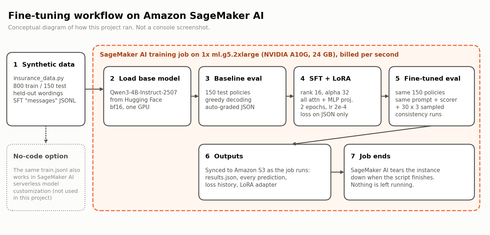

# Insurance policy exception analysis with SFT + LoRA on Amazon SageMaker AI

Fine-tune an open-weight model (`Qwen/Qwen3-4B-Instruct-2507`) with LoRA so it reads an insurance policy and a claim and returns structured JSON: the policy details, the exclusions still in force (and whether each has an exception), and the claim decision with the payable amount. The base model and the fine-tuned model are compared on 150 held-out policies.

Companion code for The Data Hustle newsletter issue *"I fine-tuned a small model to read insurance policies. Here's what LoRA changed."*

> **All data is synthetic.** Every policy, company, person and amount is generated. Results describe a proof of concept on generated data, not performance on real insurance claims.



## What's here

| Path | What it is |
| --- | --- |
| `insurance_lora_sagemaker.ipynb` | The full experiment, top to bottom |
| `insurance_data.py` | Synthetic policy generator and scoring functions (the notebook writes its own copy) |
| `train.jsonl`, `test.jsonl` | 800 training and 150 held-out test examples in the SFT chat `messages` format (seed 42) |
| `sample_policy.txt` | Test policy #3 and its expected JSON |
| `RUN_GUIDE.md` | Running the notebook in a SageMaker Studio JupyterLab space |
| `sagemaker_job/build_and_launch.py` | Running the same notebook code as a SageMaker AI training job |
| `figures/` | Scripts for the charts and the side-by-side example |
| `results/` | Measured results from the SageMaker AI run |

## The experiment

1. **Data.** Policies across commercial property, homeowners, commercial auto and cyber liability, each with 2–4 exclusions, exceptions on some, sometimes an endorsement that deletes an exclusion, and a claim notice. The generator computes the correct answer, so grading is automatic.
2. **Fair test.** Some exclusion and exception wordings, claim descriptions, date formats and money formats appear only in the test set. No test policy or policy number appears in training.
3. **Baseline.** The base model answers all 150 test policies (greedy decoding) with the full schema and rules in its system prompt. That's the prompt-only approach.
4. **SFT + LoRA.** Rank 16, alpha 32, dropout 0.05, on q/k/v/o/gate/up/down projections; 2 epochs, learning rate 2e-4 (cosine), effective batch 16, bf16, loss on the JSON answer only. 33.0M trainable parameters (0.81%).
5. **Fine-tuned eval.** Same 150 policies, same prompt, same scorer.
6. **Consistency.** 30 test policies × 3 sampled runs (temperature 0.7), both models. The base model is the same weights with the adapter disabled.

### Metrics

| Metric | Meaning |
| --- | --- |
| Valid JSON | Reply contains a parseable JSON object |
| Clean JSON only | Whole reply is a single JSON object, no extra text |
| Exact schema | Exactly the required keys and types |
| Policy fields correct | Share of the 7 policy fields that match |
| Exclusions F1 | Overlap of predicted vs true exclusions in force, incl. the exception flag |
| Claim decision correct | `covered`, `excluded`, `covered_by_exception`, `outside_policy_period` |
| Payable amount correct | min(claim, limit) − deductible, or 0 when not covered |
| Everything correct | All of the above right for that policy |

## Run it

**Option A: SageMaker Studio notebook.** Follow `RUN_GUIDE.md`: one JupyterLab space on `ml.g5.2xlarge` (1× A10G, 24 GB) with 50 GB storage, then Run All. About an hour. Stop the space afterwards.

**Option B: SageMaker AI training job** (no notebook server; billed per second, torn down automatically):

```bash
cd sagemaker_job
python build_and_launch.py build                    # turns the notebook's code cells into src/train.py
python build_and_launch.py launch ml.g5.2xlarge     # uploads to S3 and starts the job
```

Prerequisites: an IAM role named `SageMakerInsuranceLoRARole` (trust policy in `sagemaker_job/trust.json`, with `AmazonSageMakerFullAccess` attached), an S3 bucket named `sagemaker-insurance-lora-<account-id>` in your region, training-job quota for the instance type, and AWS credentials in your environment. Set `AWS_REGION` if you're not in `us-east-2`. Outputs (results, predictions, adapter) sync to the bucket under `<job-name>/checkpoints/outputs/`.

Check [SageMaker AI pricing](https://aws.amazon.com/sagemaker/ai/pricing/) for current instance rates.

## Requirements

`transformers>=4.56`, `peft>=0.15`, `accelerate>=1.5`, `pandas`, `matplotlib`, on PyTorch with CUDA. The training-job path pins `transformers==4.57.1`, `peft==0.17.1`, `accelerate==1.10.1`.
